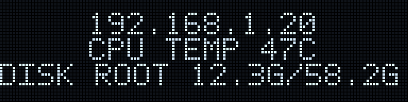

# odroid-hc4-display-noburnin

A small Rust program for the ODROID-HC4's 128×32 I²C OLED. It displays IPv4
addresses, thermal readings, and disk usage using a crisp 5×7 pixel font.
Pages alternate between three and two readings, shifting vertically between
visits to use the top and bottom margins. For an unchanged reading list, each
recurring page visits all vertical positions where its text fits equally often
over a complete cycle. Each page slides off to the left before the next slides
in from the right. Long readings scroll horizontally while the page is held.



*Preview rendered with sample data; each lit pixel is one OLED pixel.*

## Deploy on an ODROID-HC4

The device needs Linux, `iproute2` (`ip`), GNU coreutils (`df`), and access to
the OLED's I²C device. Commands below assume a shell on the HC4, for example
after connecting with `ssh USER@HC4_IP`. Choose a release binary or build from
source.

### Install a GitHub release

Once a binary release is available, this method installs its statically linked
ARM64 Linux binary without Rust or Cargo. Check that `uname -m` reports `aarch64`
and `getconf LONG_BIT` reports `64`. For 32-bit systems, build from source.

If upgrading while the systemd service is running, stop it first with
`sudo systemctl stop odroid-hc4-display.service`. Download the release archive
and checksum into a separate directory:

```sh
mkdir -p ~/odroid-hc4-display-download
cd ~/odroid-hc4-display-download
curl -fLO https://github.com/hfavisado/odroid-hc4-display-noburnin/releases/latest/download/odroid-hc4-display-aarch64-linux-musl.tar.gz &&
curl -fLO https://github.com/hfavisado/odroid-hc4-display-noburnin/releases/latest/download/odroid-hc4-display-aarch64-linux-musl.tar.gz.sha256 &&
sha256sum -c odroid-hc4-display-aarch64-linux-musl.tar.gz.sha256
```

Proceed only if the checksum reports `OK`:

```sh
tar -xzf odroid-hc4-display-aarch64-linux-musl.tar.gz
sudo install -Dm755 odroid-hc4-display /usr/local/bin/odroid-hc4-display
if [ ! -e /etc/odroid-hc4-display.conf ]; then
    sudo install -Dm644 odroid-hc4-display.conf /etc/odroid-hc4-display.conf
fi
```

The checksum detects corruption but does not independently authenticate the
download. Edit `/etc/odroid-hc4-display.conf` as needed, then follow
[the display check](#check-the-display-and-run-manually). After an upgrade,
restart the existing service with `sudo systemctl start odroid-hc4-display.service`
instead of running it manually.

### Build and install from source

Building on the HC4 also requires Git, Rust and Cargo 1.85 or newer. The program
has no Cargo dependencies. Check `rustc --version` and `cargo --version`;
if your distribution's Rust packages are too old, see the
[Rust installation instructions](https://www.rust-lang.org/tools/install).

```sh
git clone https://github.com/hfavisado/odroid-hc4-display-noburnin.git
cd odroid-hc4-display-noburnin
cargo build --release
sudo install -Dm755 target/release/odroid-hc4-display /usr/local/bin/odroid-hc4-display
```

Install the example configuration if you do not already have one, then edit it
to select the disks and readings you want:

```sh
if [ ! -e /etc/odroid-hc4-display.conf ]; then
    sudo install -Dm644 odroid-hc4-display.conf /etc/odroid-hc4-display.conf
fi
sudo nano /etc/odroid-hc4-display.conf
```

The built-in defaults are used if the config file is absent. Use `--config PATH`
to select a different file. See [Configuration](#configuration) for the options.

### Check the display and run manually

The default OLED device is `/dev/i2c-0`, at address `0x3c`. Check that the device
node exists:

```sh
ls -l /dev/i2c-0
```

If it is missing, enable I²C for your HC4 operating system. If `i2c-dev` is
available as a kernel module, `sudo modprobe i2c-dev` loads it; consult your
OS's documentation for enabling the bus and loading the module at boot. If the
bus or address differs, update `i2c_device` and `i2c_address` in the config.
The process needs read and write access to the I²C device.

Stop any other software using the OLED, then test:

```sh
sudo /usr/local/bin/odroid-hc4-display
```

The status pages should appear on the OLED. Press **Ctrl+C** to stop the manual
process before starting a service; only one process should drive the display.

### Start automatically with systemd

On systems using systemd, install the service file from the release archive or
source checkout. The command preserves an existing unit so local customizations
are not overwritten:

```sh
if [ ! -e /etc/systemd/system/odroid-hc4-display.service ]; then
    sudo install -Dm644 odroid-hc4-display.service /etc/systemd/system/odroid-hc4-display.service
fi
sudo systemctl daemon-reload
sudo systemctl enable --now odroid-hc4-display.service
sudo systemctl status --no-pager odroid-hc4-display.service
```

The service runs as root by default so it can access the I²C device. To use a
less privileged account, configure `User=` and ensure that account has read
and write access to the device.

To inspect errors or restart after editing the config:

```sh
sudo journalctl -u odroid-hc4-display.service -b --no-pager
sudo systemctl restart odroid-hc4-display.service
```

For source-build updates, build the new source on the HC4, stop the service,
reinstall the binary, and start the service again. Keep your existing config:

```sh
cargo build --release
sudo systemctl stop odroid-hc4-display.service
sudo install -Dm755 target/release/odroid-hc4-display /usr/local/bin/odroid-hc4-display
sudo systemctl start odroid-hc4-display.service
```

If you build on another computer, cross-compile for the HC4's Linux architecture;
a macOS build cannot run on the HC4.

## Publish a GitHub release

The release workflow runs when a `v*` tag is pushed. It checks that the tag is
`vMAJOR.MINOR.PATCH` and matches `Cargo.toml`, tests the ARM64 musl build,
and packages the binary, config, and systemd service. It creates a draft GitHub
Release, uploads the archive and SHA-256 checksum, downloads and verifies both,
then publishes the release.

Commit and push the release changes, including any version change in
`Cargo.toml` and `Cargo.lock`. Merge the workflow into the default branch
before tagging. Create and push an annotated tag matching the version (replace
`v0.1.0` with the version being released):

```sh
git tag -a v0.1.0 -m "Release v0.1.0"
git push origin v0.1.0
```

Check the **Release** workflow in GitHub Actions and then the
[Releases page](https://github.com/hfavisado/odroid-hc4-display-noburnin/releases).
The repository must permit Actions to write contents. If a run fails after
creating a draft, remove that incomplete draft before re-running the failed
workflow; do not delete the tag. A published release is not overwritten.
Manually publishing a release bypasses these checks. CI does not test the OLED
hardware, so test the release binary on an HC4 as well.

## Preview without hardware

`--preview` renders four to eight pages of the animation to a GIF and exits,
without touching the I²C device, so it works on any Linux/macOS machine with Rust:

```sh
cargo run --release -- --preview docs/preview.gif            # sample data
cargo run --release -- --preview out.gif --live              # this machine's IPs, temps, disks
cargo run --release -- --config my.conf --preview out.gif    # honours page_interval_ms
```

The GIF is written by a built-in encoder (no extra crates). It loops after a
short sample of the sequence; the real display continues through all vertical
positions. The one in this README is `docs/preview.gif`; regenerate it with the
first command after changing the rendering code.

## Configuration

The config file is plain `key=value`; blank lines and lines beginning with `#`
are ignored. Boolean values are `true` or `false`. For example:

```ini
show_ipv4=true
show_temperature=true
show_disks=true
network_interface=eth0
disk=/
disk=/mnt/data
i2c_device=/dev/i2c-0
i2c_address=0x3c
page_interval_ms=5000
refresh_ms=100
```

`network_interface` is optional; when unset, IPv4 addresses from all interfaces
with a global address are shown. Each `disk` line adds a mount path to display; the
default is `/`. Configure one line per mounted filesystem you want to monitor.
`page_interval_ms` is the minimum time a page remains stationary in milliseconds
(1000–60000). A page with a long reading stays longer if needed to show the
entire reading. `refresh_ms` is the display refresh interval in milliseconds
(20–2000); the sleep between animation frames is capped at 100 ms.
Existing `scroll_speed` settings are accepted for compatibility but no longer
affect the display. Disabling all three `show_*` settings leaves the display blank.
The list repeats continuously; if it has an even number of readings, one blank
line is appended before paging. Animation can spread usage but cannot guarantee
perfectly even wear.

## Data sources

- IPv4: `ip -o -4 addr show scope global` (`iproute2`).
- Temperature: Linux thermal-zone `type` and `temp` files under
  `/sys/class/thermal/`; on HC4 this includes the SoC thermal reading, reported
  by the kernel in thousandths of a degree Celsius.
- Disk usage: `df -B1 --output=size,used,pcent MOUNT_PATH` for each configured
  mount path (GNU coreutils).
- Display: SSD1306-compatible I²C device, configured with the I²C device path
  and 7-bit address.

Unavailable readings are skipped where possible; a missing IPv4 address,
temperature sensor, or mount is shown as `N/A`/`NO ADDRESS` rather than stopping
the display.

## Credits

Hardware and thermal-source information follows the
[ODROID-HC4 OLED documentation](https://wiki.odroid.com/odroid-hc4/application_note/oled).
The system-status display concept and storage configuration were informed by
[rpardini/sys-oled-hc4](https://github.com/rpardini/sys-oled-hc4), which in turn
credits the original [kobol-io/sys-oled](https://github.com/kobol-io/sys-oled).
