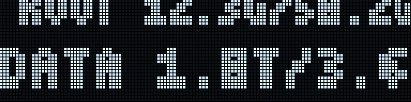

# odroid-hc4-display-noburnin

A small Rust program for the ODROID-HC4's 128×32 I²C OLED. It displays IPv4
addresses, thermal readings, and disk usage as a repeating, perspective-style
credits roll: lines enter large from the bottom, shrink while moving upward,
and return to the bottom after leaving the top to reduce static OLED content.



*Preview rendered with sample data; each lit pixel is one OLED pixel.*

## Build and run

The program has no Cargo dependencies and targets Linux. Build it on the HC4
(or cross-compile for its Linux architecture):

```sh
cargo build --release
sudo install -Dm755 target/release/odroid-hc4-display /usr/local/bin/odroid-hc4-display
sudo install -Dm644 odroid-hc4-display.conf /etc/odroid-hc4-display.conf
sudo /usr/local/bin/odroid-hc4-display
```

The example configuration is included in this repository. The built-in defaults
are used if `/etc/odroid-hc4-display.conf` is absent. Use `--config PATH` to
select another configuration. The process needs write access to the I²C device
(by default `/dev/i2c-1`); enable the Linux `i2c-dev` interface and run it as
root or grant the service account access to that device.

## Preview without hardware

`--preview` renders one full scroll loop to an animated GIF and exits, without
touching the I²C device, so it works on any Linux/macOS machine with Rust:

```sh
cargo run --release -- --preview docs/preview.gif            # sample data
cargo run --release -- --preview out.gif --live              # this machine's IPs, temps, disks
cargo run --release -- --config my.conf --preview out.gif    # honours scroll_speed / refresh_ms
```

The GIF is written by a built-in encoder (no extra crates) and loops seamlessly.
The one in this README is `docs/preview.gif`; regenerate it with the first
command after changing the rendering code.

## Configuration

The config file is plain `key=value`; blank lines and lines beginning with `#`
are ignored. Boolean values are `true` or `false`. For example:

```ini
show_ipv4=true
show_temperature=true
show_disks=true
network_interface=eth0
disk=/
disk=/mnt/data
i2c_device=/dev/i2c-1
i2c_address=0x3c
scroll_speed=5
refresh_ms=100
```

`network_interface` is optional; when unset, IPv4 addresses from all interfaces
with a global address are shown. Each `disk` line adds a mount path to display; the
default is `/`. Configure one line per mounted filesystem you want to monitor.
`scroll_speed` is pixels per second (0.1–100), and `refresh_ms` is the frame
interval in milliseconds (20–2000). Disabling all three `show_*` settings
leaves the display blank.

## Data sources

- IPv4: `ip -o -4 addr show scope global` (`iproute2`).
- Temperature: Linux thermal-zone `type` and `temp` files under
  `/sys/class/thermal/`; on HC4 this includes the SoC thermal reading, reported
  by the kernel in thousandths of a degree Celsius.
- Disk usage: `df -B1 --output=size,used,pcent MOUNT_PATH` for each configured
  mount path (GNU coreutils).
- Display: SSD1306-compatible I²C device, configured with the I²C device path
  and 7-bit address.

Unavailable readings are skipped where possible; a missing IPv4 address,
temperature sensor, or mount is shown as `N/A`/`NO ADDRESS` rather than stopping
the display.

## Credits

Hardware and thermal-source information follows the
[ODROID-HC4 OLED documentation](https://wiki.odroid.com/odroid-hc4/application_note/oled).
The system-status display concept and storage configuration were informed by
[rpardini/sys-oled-hc4](https://github.com/rpardini/sys-oled-hc4), which in turn
credits the original [kobol-io/sys-oled](https://github.com/kobol-io/sys-oled).
